# Казанцев Иван ЛА-2 Лабораторная №4 Вариант 5

---

# Задание 1

## Задача 5

### Текст задачи

Составить программу, которая удаляет из списка L все элементы с указанным значением.

### Алгоритм решения

1. Ввести количество элементов списка.
2. Создать список целых чисел.
3. Заполнить список числами, введенными с клавиатуры.
4. Ввести значение, которое необходимо удалить.
5. Найти в списке все элементы, равные заданному значению.
6. Удалить найденные элементы.
7. Вывести полученный список.

### Тестирование

### Пример работы

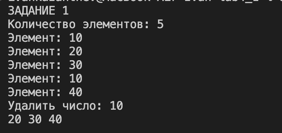

### Проверка ввода

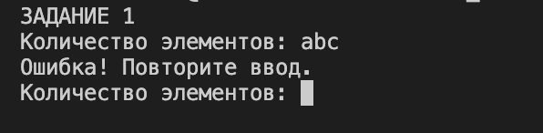

---

# Задание 2

## Задача 5

### Текст задачи

В списке L переставить в обратном порядке все элементы между первым и последним вхождениями элемента E, если E входит в L не менее двух раз.

### Алгоритм решения

1. Ввести количество элементов списка.
2. Создать двусвязный список целых чисел.
3. Заполнить список числами, введенными с клавиатуры.
4. Ввести значение элемента E.
5. Найти первое вхождение элемента E.
6. Найти последнее вхождение элемента E.
7. Если элемент E встречается менее двух раз, оставить список без изменений.
8. Если найдено не менее двух вхождений, переставить элементы между ними в обратном порядке.
9. Вывести полученный список.

### Тестирование

### Пример работы

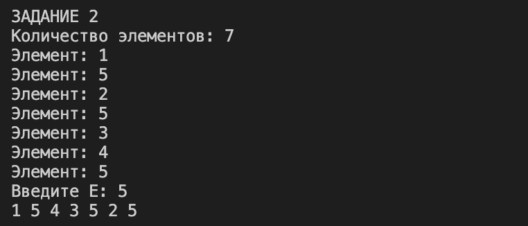

### Проверка ввода

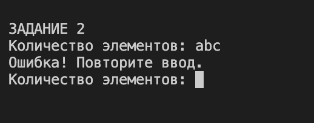

---

# Задание 3

## Задача 5

### Текст задачи

Есть перечень фильмов. Определить для каждого фильма, какие из них посмотрели все n зрителей, какие — некоторые из зрителей, и какие — никто из зрителей.

### Алгоритм решения

1. Ввести количество фильмов.
2. Ввести названия фильмов.
3. Вывести список фильмов с номерами.
4. Ввести количество зрителей.
5. Для каждого зрителя ввести номера просмотренных фильмов.
6. Если зритель ничего не смотрел, ввести 0.
7. Определить фильмы, которые посмотрели все зрители.
8. Определить фильмы, которые посмотрели некоторые зрители.
9. Определить фильмы, которые не посмотрел никто.
10. Вывести три полученные группы фильмов.

### Тестирование

### Пример работы

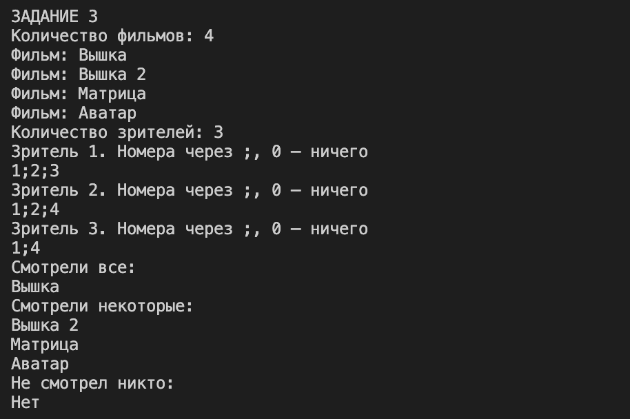

### Проверка ввода

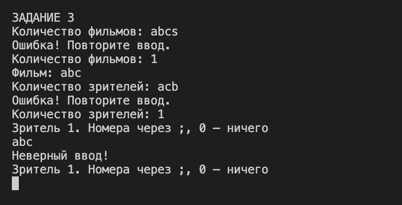

---

# Задание 4

## Задача 5

### Текст задачи

Файл содержит текст на русском языке. Напечатать в алфавитном порядке все звонкие согласные буквы, которые входят более чем в одно слово.

### Алгоритм решения

1. Создать текстовый файл с исходным текстом.
2. Прочитать текст из файла.
3. Разделить текст на отдельные слова.
4. Проверить слова на наличие звонких согласных букв.
5. Определить звонкие согласные буквы, которые встречаются более чем в одном слове.
6. Вывести найденные буквы в алфавитном порядке.

### Тестирование

### Пример работы

### Проверка ввода

---

# Задание 5

## Задача 5

### Текст задачи

На вход программе подаются сведения о телефонах всех сотрудников некоторого учреждения. В первой строке сообщается количество сотрудников N, каждая из следующих N строк имеет следующий формат:

`<Фамилия><Инициалы><телефон>`

где `<Фамилия>` – строка, состоящая не более чем из 20 символов, `<Инициалы>` – строка, состоящая не более чем из 4-х символов (буква, точка, буква, точка), `<телефон>` – семизначный номер, 3-я и 4-я, а также 5-я и 6-я цифры которого разделены символом «–». `<Фамилия>` и `<Инициалы>`, а также `<Инициалы>` и `<телефон>` разделены одним пробелом. Пример входной строки:

`Иванов П.С. 555-66-77`

Сотрудники одного подразделения имеют один и тот же номер телефона. Номера телефонов в учреждении отличаются только двумя последними цифрами. Требуется написать эффективную программу, которая будет выводить на экран информацию, сколько в среднем сотрудников работает в одном подразделении данного учреждения.

### Алгоритм решения

1. Ввести количество сотрудников.
2. Для каждого сотрудника ввести фамилию, инициалы и номер телефона.
3. Проверить правильность введенных данных.
4. Записать сведения о сотрудниках в текстовый файл.
5. Прочитать данные из файла.
6. Определить подразделения по основной части номеров телефонов.
7. Подсчитать общее количество сотрудников.
8. Определить количество подразделений.
9. Разделить количество сотрудников на количество подразделений.
10. Вывести среднее количество сотрудников в одном подразделении.

### Тестирование

### Пример работы

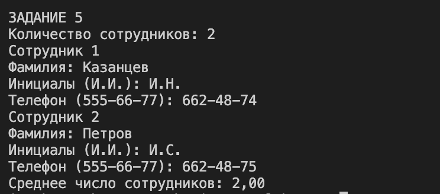

### Проверка ввода

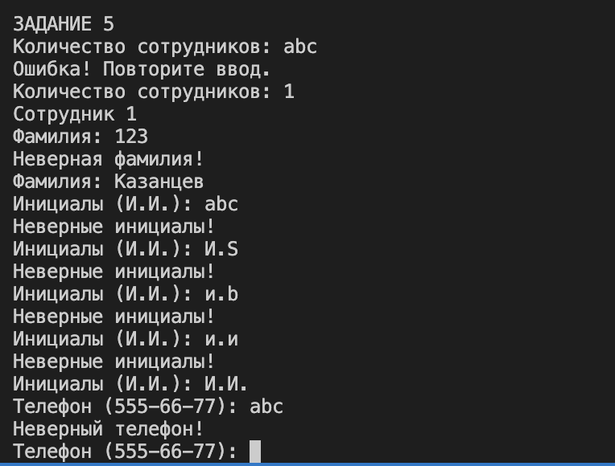

---

# Задание 6

## Задача 5

### Текст задачи

Класс: `LineSegment`.

Поля: `double x, double y` (координаты начала и конца отрезка на координатной прямой).

Метод:

Определить, попадает ли заданное число в отрезок. Результат должен быть типа `bool`.

### Алгоритм решения

1. Создать класс `LineSegment`.
2. Объявить два закрытых поля для хранения координат начала и конца отрезка.
3. Создать свойства для доступа к координатам.
4. Создать конструкторы для задания координат отрезка.
5. Переопределить метод `ToString()` для вывода координат отрезка.
6. Реализовать метод `Contains()`, который принимает число для проверки.
7. Проверить, попадает ли число в границы отрезка.
8. Вернуть `true`, если число попадает в отрезок, и `false` в противном случае.
9. Проверить работу конструкторов и методов.
10. Вывести результаты на экран.

### Тестирование

### Пример работы

### Проверка ввода

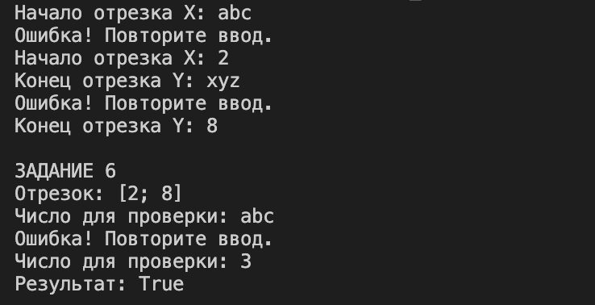

---

# Задание 7

## Задача 5

### Текст задачи

Класс: `LineSegment`.

Унарные операции:

- `!` - вычислить длину отрезка, результат должен быть типа `double`;
- `++` - увеличить координаты границ отрезка на 1.

Операции приведения типа:

- `int` (явная) - результатом является целая часть координаты x;
- `double` (неявная) - результатом является координата y.

Бинарные операции:

- `+ int d`, целое число (лево- и правосторонняя операция, координаты границ увеличиваются на число d);
- `< LineSegment, целое число` - результат равен `true`, если целое число попадает в заданный отрезок и `false` - в противном случае.

### Алгоритм решения

1. Использовать созданный в задании 6 класс `LineSegment`.
2. Перегрузить оператор `!` для вычисления длины отрезка.
3. Перегрузить оператор `++` для увеличения координат границ отрезка на 1.
4. Реализовать явное преобразование объекта к типу `int`, возвращающее целую часть координаты x.
5. Реализовать неявное преобразование объекта к типу `double`, возвращающее координату y.
6. Перегрузить оператор `+` для увеличения обеих координат на заданное целое число.
7. Реализовать сложение как с числом слева, так и с числом справа от объекта.
8. Перегрузить оператор `<` для проверки попадания целого числа в отрезок.
9. Проверить работу всех перегруженных операторов и преобразований.
10. Вывести результаты на экран.

### Тестирование

### Пример работы

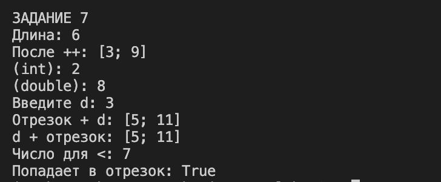

### Проверка ввода

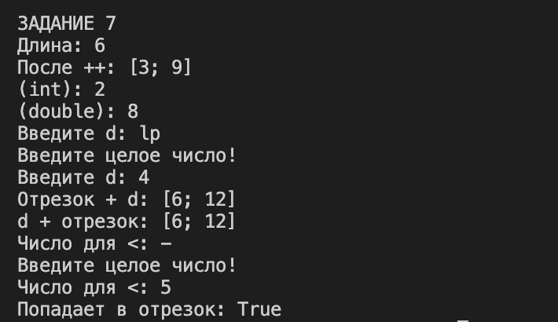
